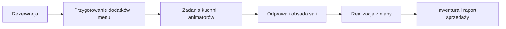
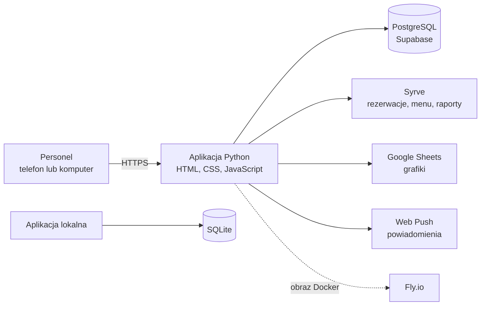

# KidsOffice

### System operacyjny dla parku rozrywki

**Realizacja: 221studio** · Aplikacja wewnętrzna · Interfejs mobilny i desktopowy

W 221studio stworzyliśmy aplikację, która porządkuje codzienną pracę parku rozrywki: od rezerwacji urodzin i przygotowania atrakcji, przez odprawę zespołu, po inwenturę i raporty sprzedaży. Każdy dział pracuje na tych samych danych, ale widzi zadania dopasowane do swojej roli.

## Wyzwanie

Obsługa jednego dnia łączy wiele zależnych od siebie zadań. Rezerwacja bankietu wpływa na przygotowanie kuchni, animatorów, recepcji i obsługi sali. Do tego dochodzą grafiki, przydział stref, zapasy i rozliczenia. Informacje z POS i arkusza grafików muszą być dostępne w tym samym kontekście co praca personelu.

Najważniejszym problemem projektowym było połączenie tych procesów bez tworzenia jednego przeładowanego panelu. Organizator, kuchnia i kierownik zmiany potrzebują różnych widoków, lecz muszą pracować na wspólnym planie dnia.

## Rozwiązanie

Zaprojektowaliśmy aplikację mobilną z widokami odpowiadającymi rolom i zadaniom personelu. Rezerwacja jest punktem wyjścia dla przygotowań wielu działów, a odprawa, grafiki, inwentura i statystyki obsługują pozostałe części zmiany.

### Główne obszary produktu

| Obszar | Co obsługuje |
|---|---|
| Rezerwacje | Bankiety urodzinowe i rezerwacje stolików, gości, lokalizacje na planie sali, dodatki, torty i pozycje menu. |
| Widoki działów | Zadania organizatorów, recepcji, animatorów, kuchni, HR, serwisu i kierowników zmiany. |
| Odprawa | Obsada stref sali, raport zmiany i materiały do wydruku. |
| Grafiki | Tygodniowe i miesięczne grafiki działów, synchronizowane z arkusza. |
| Inwentura | Stany magazynowe, zapotrzebowanie powiązane z rezerwacjami, zakupy i wydania. |
| Statystyki | Miesięczne zestawienia bankietów, sprzedaży stolikowej i operacji. |

## Przepływ pracy

Przykładowo bankiet może zawierać kilka tortów, pozycje menu, animacje i przypisanie kelnera. Kuchnia i animatorzy dostają własne listy pracy, a kierownik zmiany układa obsadę sali. Po zakończeniu dnia dane sprzedażowe są zapisywane w migawce wykorzystywanej w raportach.

## Architektura

Aplikacja działa jako jeden serwis webowy. Lokalnie może używać SQLite, a wdrożenie hostowane korzysta z PostgreSQL. Integracje z Syrve i Google Sheets dostarczają dane potrzebne w procesach operacyjnych; raporty miesięczne korzystają z zapisanych migawek. Środowisko testowe ma własną bazę danych.

### Stos technologiczny

| Technologia | Rola w projekcie |
|---|---|
| Python 3.12+ | Serwer HTTP, logika rezerwacji i procesów operacyjnych. |
| HTML, CSS, JavaScript | Interfejs dostępny z telefonów i komputerów, bez osobnego serwera frontendu. |
| Vite, PostCSS | Budowanie i optymalizacja arkuszy CSS. |
| SQLite, PostgreSQL | SQLite dla pracy lokalnej, PostgreSQL dla wdrożenia hostowanego. |
| Syrve | Dane POS wykorzystywane w rezerwacjach, menu i raportowaniu. |
| Google Sheets API | Źródło grafików personelu. |
| Web Push | Powiadomienia przeglądarkowe. |
| Docker, Fly.io | Powtarzalne pakowanie i wdrażanie aplikacji. |

## Decyzje i wyzwania techniczne

- **Rola a widok działu:** oddzieliliśmy uprawnienia urządzenia od aktualnie otwartego ekranu, aby zmiana widoku nie zmieniała kontekstu dostępu.
- **Rezerwacja jako źródło zadań:** rozdzieliliśmy dane rezerwacji od powtarzalnych pozycji menu, historii zmian i zapotrzebowania magazynowego.
- **Dane zewnętrzne:** odseparowaliśmy integracje, lokalne odwzorowanie danych POS i miesięczne migawki raportowe od bieżącej edycji rezerwacji.
- **Bezpieczne migracje:** produkcyjny start aplikacji nie modyfikuje schematu. Migracje uruchamiamy osobno, najpierw w trybie próbnym, a zmiany produkcyjne wymagają jawnego potwierdzenia.

Więcej szczegółów: [architektura](docs/architecture.md), [wyzwania techniczne](docs/technical-challenges.md) i [przepływy operacyjne](docs/przeplywy-operacyjne.md).

---

Case study przedstawia projekt pod nazwą **KidsOffice**. Repozytorium zawiera dokumentację projektu; kod aplikacji i dane operacyjne pozostają w prywatnym repozytorium.
