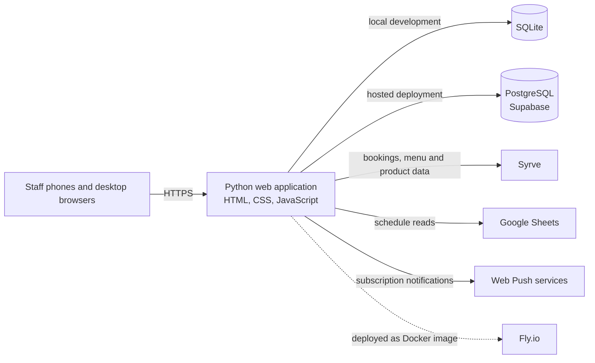
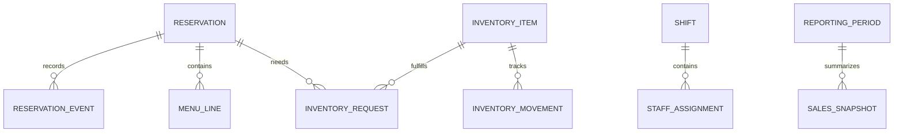

# Park Operations Platform — Case Study

> A documentation-only portfolio case study. Application source code, customer data, credentials, and production screenshots are not included.

I designed and built a mobile-first operations platform for a family entertainment venue. It brings the day’s bookings, staff handoffs, department tasks, inventory, and operational reporting into one shared workflow that staff can use from phones or desktop browsers.

**Project type:** Internal operations platform · **Focus:** Product engineering, system design, integrations, operational safety

## The problem

Daily work crossed several roles and tools: staff needed to coordinate birthday bookings, floor assignments, schedules, kitchen and animator tasks, stock, and sales reporting. A change made in one place had to remain understandable to the next team taking over the shift. Some reference data also lived in external systems.

The platform gives each department a focused view of the same operating day while keeping the underlying reservation and operational records connected.

## What the platform supports

- Birthday banquets and table reservations, with add-ons, menu lines, change history, and cancellation history.
- Role-oriented mobile views for organizers, shift leads, reception, animators, kitchen, HR, and service teams.
- Shift briefings, waiter-zone assignments, department schedules, and animator cleaning assignments.
- Inventory counts, reservation-linked requests, shopping lists, and issue tracking.
- Monthly operational reporting, including separate banquet and walk-in table-sales snapshots.
- Integration paths for the POS, staff scheduling sheet, push notifications, and cloud-hosted relational storage.

## Business value

The product consolidates recurring shift work into one shared operational surface. It makes handoffs more explicit, gives departments task-specific views, and keeps booking changes traceable. The repository does not contain verified time-savings or revenue measurements, so this case study makes no quantified ROI claim.

## System architecture

The production design is a small server-rendered web application packaged as a Docker image. The application serves the mobile interface and coordinates persistence and external integrations. SQLite supports local development; the hosted setup uses PostgreSQL. External systems are accessed through dedicated integration paths, with selected data mirrored or snapshotted locally for operational reads.

The diagram is a high-level view based on the project’s deployment and integration configuration. It intentionally omits customer identifiers, hostnames, credentials, and network details.

## Technical decisions

| Decision | Reason |
|---|---|
| Python application with a lightweight HTTP layer | Keeps the operational workflows in a small deployable service without requiring a separate frontend server. |
| HTML, CSS, and JavaScript with a mobile-first interface | Staff use the system during active shifts, often from phones; core tasks need to remain direct and quick to reach. |
| SQLite locally and PostgreSQL in the hosted environment | Makes local development self-contained while supporting a managed relational database in deployment. |
| Explicit role and department views | Different staff need different actions and information, while a device’s staff role remains distinct from the currently open department screen. |
| External-system adapters and local snapshots | Keeps the core workflow usable when external data must be read, reconciled, or reported on separately. |
| Docker and staged deployment configuration | Gives production and staging repeatable application packaging and a place to verify changes against an isolated database. |

## Selected technical challenges

See [Technical challenges](docs/technical-challenges.md) for the problem, design approach, and outcome for each item. Topics include role-aware workflows, external-system synchronization, auditable operational history, and safe database migrations.

## Data model

The data model connects reservations with their history, menu lines, inventory requests, staffing assignments, and reporting snapshots. The full schema is intentionally not published; this conceptual diagram uses generic entities and excludes personal data and customer-specific fields.

## Evidence and screenshots

No production screenshots or live-system link are included in this public-facing draft. They can be added after confirming client permission and replacing real names, logos, and operational data with approved or generated examples. No fabricated screenshots or metrics are used.

## Scope and privacy

This repository is a case study, not a runnable application. It contains no application source, database dumps, credentials, customer records, or client-specific deployment identifiers. See [Scope and privacy](docs/scope-and-privacy.md) before adding screenshots, a live link, or code excerpts.

## About this case study

This write-up focuses on system design and engineering trade-offs. It avoids disclosing the customer’s identity and operational details until public portfolio use is confirmed as permitted.
