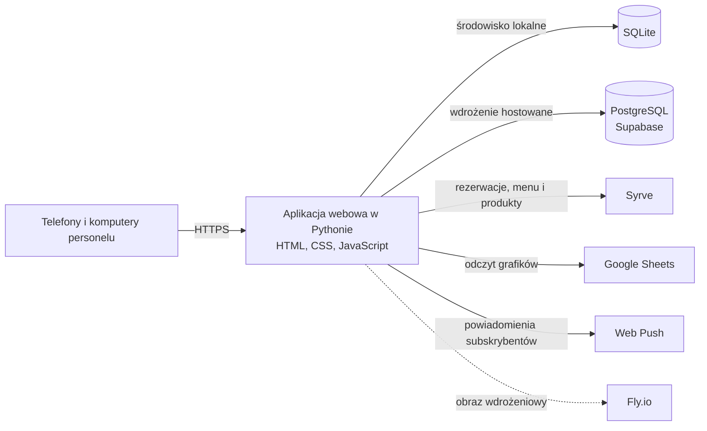
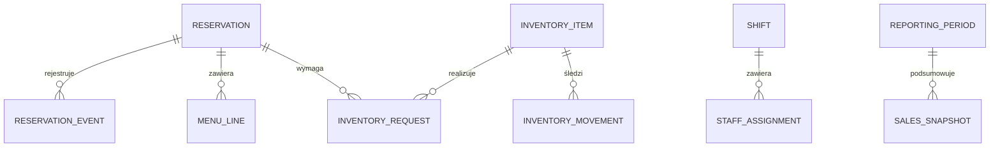

# Platforma operacyjna parku — case study

> Publiczne case study zawierające wyłącznie dokumentację. Nie zawiera kodu aplikacji, danych klienta, danych logowania ani zrzutów ekranu z produkcji.

Zaplanowałem i zbudowałem mobilną platformę operacyjną dla rodzinnego centrum rozrywki. Łączy ona rezerwacje, przekazanie zmiany, zadania działów, inwenturę i raportowanie w jednym systemie dostępnym z telefonu i komputera.

**Typ projektu:** wewnętrzna platforma operacyjna · **Zakres:** inżynieria produktu, projektowanie systemu, integracje i bezpieczeństwo operacyjne

## Problem

Codzienna praca obejmowała wiele ról i narzędzi. Zespoły musiały koordynować rezerwacje urodzinowe, obsadę sali, grafiki, zadania kuchni i animatorów, zapasy oraz raporty sprzedaży. Informacje musiały być zrozumiałe dla kolejnego zespołu przejmującego zmianę, a część danych źródłowych znajdowała się w zewnętrznych systemach.

Platforma udostępnia każdemu działowi dopasowany widok tego samego dnia pracy, zachowując powiązania między rezerwacjami a zadaniami operacyjnymi.

## Zakres produktu

- Bankiety urodzinowe i rezerwacje stolików, wraz z dodatkami, pozycjami menu, historią zmian i anulowań.
- Mobilne widoki dla organizatorów, kierowników zmiany, recepcji, animatorów, kuchni, HR i serwisu.
- Odprawy zmianowe, przypisania kelnerów do stref, grafiki działów i zadania sprzątania dla animatorów.
- Ewidencja zapasów, zapotrzebowanie powiązane z rezerwacjami, lista zakupów i śledzenie wydań.
- Miesięczne raporty operacyjne, z osobnymi migawkami sprzedaży bankietowej i codziennej sprzedaży stolikowej.
- Integracje z systemem POS, arkuszem grafików, powiadomieniami push i relacyjną bazą danych w chmurze.

## Wartość biznesowa

Produkt skupia powtarzalne zadania związane ze zmianą w jednym wspólnym miejscu. Ułatwia przekazywanie obowiązków, daje działom widoki dopasowane do ich zadań i pozwala prześledzić zmiany rezerwacji. Repozytorium nie zawiera zweryfikowanych pomiarów oszczędności czasu ani wzrostu przychodów, dlatego nie podaję liczbowego zwrotu z inwestycji.

## Architektura systemu

System produkcyjny jest aplikacją webową renderowaną po stronie serwera i pakowaną jako obraz Docker. Aplikacja obsługuje interfejs mobilny oraz koordynuje zapis danych i integracje zewnętrzne. Lokalnie korzysta z SQLite, a wdrożenie hostowane używa PostgreSQL. Wybrane dane z usług zewnętrznych są lokalnie odwzorowywane lub zapisywane w migawkach, aby wspierać odczyty operacyjne.

Diagram przedstawia ogólny obraz oparty na konfiguracji wdrożeń i integracji projektu. Pomija identyfikatory klienta, adresy hostów, dane dostępowe i szczegóły sieci.

## Decyzje techniczne

| Decyzja | Uzasadnienie |
|---|---|
| Aplikacja w Pythonie z lekką warstwą HTTP | Utrzymuje przepływy operacyjne w niewielkiej usłudze, bez osobnego serwera frontendu. |
| HTML, CSS i JavaScript oraz interfejs mobilny | Personel korzysta z systemu podczas zmiany, często na telefonie; podstawowe zadania powinny być szybkie do znalezienia. |
| SQLite lokalnie i PostgreSQL w środowisku hostowanym | Ułatwia lokalny rozwój, a jednocześnie zapewnia zarządzaną relacyjną bazę w produkcji. |
| Osobne role personelu i widoki działów | Każdy zespół potrzebuje innych informacji i działań, a rola urządzenia pozostaje niezależna od aktualnie otwartego widoku działu. |
| Adaptery integracyjne i lokalne migawki | Oddzielają podstawowy przepływ pracy od odczytu, uzgadniania i raportowania danych z usług zewnętrznych. |
| Docker i osobna konfiguracja środowiska testowego | Zapewniają powtarzalne pakowanie aplikacji i możliwość sprawdzania zmian na odizolowanej bazie. |

## Najważniejsze wyzwania techniczne

W dokumencie [Wyzwania techniczne](docs/technical-challenges.md) opisuję problemy, podejście projektowe i rezultaty. Omawiam role i przepływy pracy, synchronizację zewnętrznych systemów, historię operacyjną oraz bezpieczne migracje bazy.

## Model danych

Model łączy rezerwacje z historią zmian, pozycjami menu, zapotrzebowaniem magazynowym, przydziałami personelu i migawkami raportowymi. Pełny schemat nie jest publikowany; poniższy diagram przedstawia uogólnione encje i nie zawiera danych osobowych ani pól specyficznych dla klienta.

## Materiały wizualne

W tej wersji nie publikuję zrzutów ekranu ani linku do systemu produkcyjnego. Można je dodać po potwierdzeniu zgody klienta oraz zastąpieniu prawdziwych nazw, logo i danych operacyjnych zatwierdzonymi lub wygenerowanymi przykładami. Nie używam fikcyjnych zrzutów ani wymyślonych wskaźników.

## Zakres i prywatność

To repozytorium jest case study, a nie uruchamialną aplikacją. Nie zawiera kodu źródłowego, zrzutów bazy, danych logowania, rekordów klientów ani identyfikatorów wdrożenia. Zasady dodawania materiałów opisuję w dokumencie [Zakres i prywatność](docs/scope-and-privacy.md).

## O tym case study

Opis koncentruje się na projekcie systemu i kompromisach inżynierskich. Nie ujawnia tożsamości klienta ani szczegółów jego działalności, dopóki publiczne wykorzystanie portfolio nie zostanie potwierdzone jako dozwolone.
