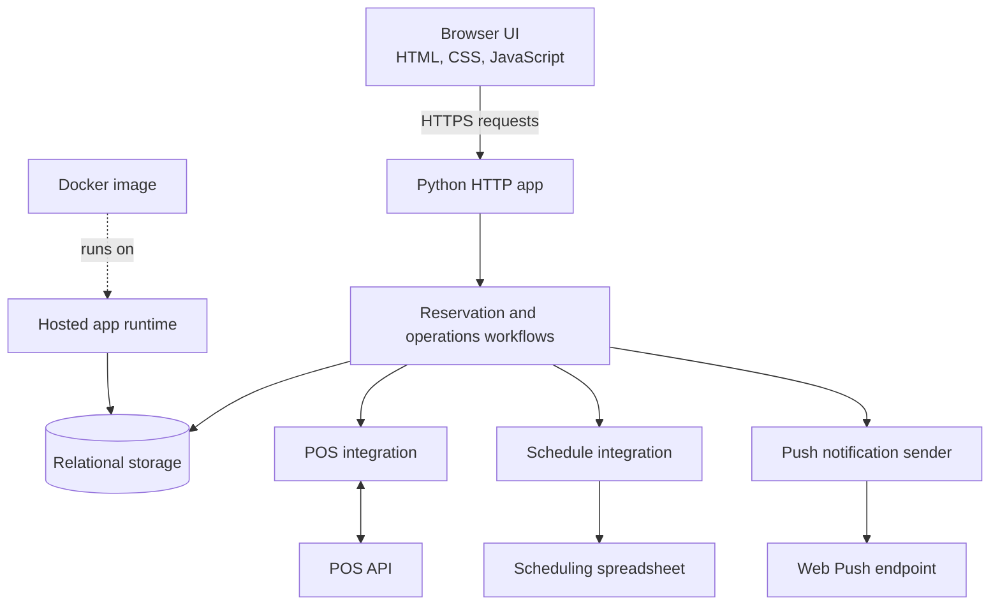
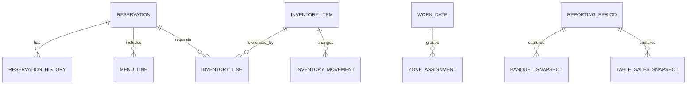

# Architecture overview

## Runtime shape

The product is a small Python web application. It serves a browser-based, mobile-first interface and owns the operational request flow. CSS is built as an asset before deployment; the application itself is packaged in Docker and deployed to a hosted application platform.

## Persistence and data boundaries

- **Operational records:** reservations, changes, staffing assignments, inventory, and related tasks.
- **External reference data:** selected POS menu and product data, refreshed into a local read model where needed.
- **Schedules:** sourced from a scheduling spreadsheet and refreshed into the app’s operational views.
- **Reporting snapshots:** captured monthly values used for historical reporting, separate from live reservation editing.
- **Local development:** SQLite keeps setup self-contained.
- **Hosted deployment:** PostgreSQL provides the production relational store.

## Conceptual entity relationships

The entity names are generalized for portfolio use. This is not an export of the production schema.

## Integration principles

1. Keep provider-specific calls behind integration modules.
2. Distinguish locally owned operational data from data read from an external source.
3. Capture historical reporting values when a stable point-in-time view is needed.
4. Keep staging storage isolated from production storage.
5. Apply production schema changes through an explicit migration command rather than app startup.

## Technology choices

| Area | Technology | Role |
|---|---|---|
| Application | Python 3.12+ | HTTP handling and operational workflows |
| Interface | HTML, CSS, JavaScript | Mobile-first browser interface |
| CSS build | Vite and PostCSS | Build and minify CSS assets |
| Local database | SQLite | Self-contained development and local demo |
| Hosted database | PostgreSQL | Hosted relational persistence |
| Deployment | Docker and Fly.io | Repeatable application image and hosted runtime |
| POS integration | Syrve APIs | Reservation, menu, and reporting data paths |
| Schedule source | Google Sheets API | Staff schedule reads |
| Notifications | Web Push | Browser push notifications |
