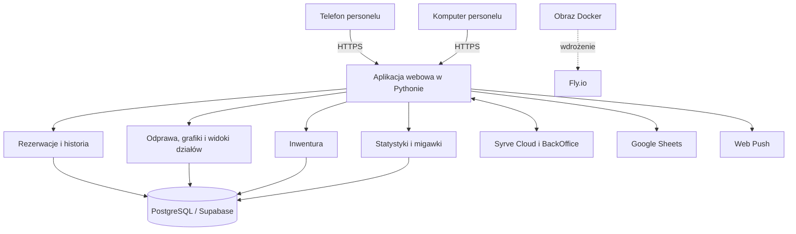
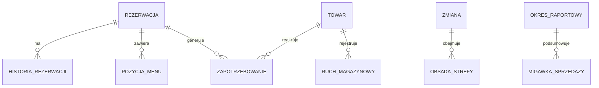

# Architektura KidsOffice

## Aplikacja

KidsOffice jest aplikacją webową w Pythonie. Serwer obsługuje interfejs HTML, zasoby CSS i JavaScript oraz żądania operacyjne. Jeden serwis odpowiada za rezerwacje, ekrany działów i integracje, dzięki czemu pracownicy korzystają ze wspólnego stanu systemu.

Interfejs jest przygotowany do pracy na małych ekranach, a te same procesy są dostępne na komputerze. CSS budujemy przed wdrożeniem. Obraz aplikacji jest uruchamiany na Fly.io.

## Dane i odpowiedzialności

- **Rezerwacja** przechowuje typ, termin, gości, lokalizację na planie, dodatki i powiązane pozycje menu.
- **Historia rezerwacji** zapisuje zmiany wraz z rolą, która je wykonała. Usunięte rezerwacje mają osobny zapis historii.
- **Menu i POS** korzystają z lokalnego odwzorowania wybranych grup i produktów Syrve; pozycje menu są powiązane z rezerwacją.
- **Inwentura** obejmuje pozycje magazynowe, zapotrzebowanie dla rezerwacji, zakupy i ruchy magazynowe.
- **Obsada zmiany** łączy datę pracy, strefę i przypisany personel.
- **Raporty** przechowują miesięczne migawki sprzedaży bankietowej i stolikowej, aby zachować wartości z danego okresu.
- **Grafiki** są pobierane z Google Sheets, a nie edytowane jako główne dane w aplikacji.

## Model pojęciowy

Model oddziela szczegóły pojedynczej rezerwacji od danych powtarzalnych i historycznych. Pozwala to zachować historię, obsłużyć wiele pozycji menu lub tortów i łączyć rezerwacje z zadaniami kolejnych działów.

## Integracje

| System | Wykorzystanie w KidsOffice |
|---|---|
| Syrve Cloud | Integracja rezerwacji, menu i produktów. |
| Syrve BackOffice | Odczyt danych wykorzystywanych w statystykach. |
| Google Sheets | Źródło grafików personelu. |
| Supabase / PostgreSQL | Relacyjna baza dla wdrożenia hostowanego. |
| Web Push | Powiadomienia dla subskrybentów. |

Integracje są wydzielone od widoków działów. Dane katalogowe POS są lokalnie odwzorowywane tam, gdzie aplikacja potrzebuje ich do pracy, natomiast raporty okresowe korzystają z zapisanych migawek.

## Środowiska i migracje

Podczas lokalnego rozwoju aplikacja może korzystać z SQLite. Wdrożenie hostowane korzysta z PostgreSQL. Środowisko testowe ma osobną bazę i nie wykonuje operacji na bazie produkcyjnej.

Migracje uruchamiamy niezależnie od startu aplikacji. Najpierw można zobaczyć plan zmian, a wykonanie migracji produkcyjnej wymaga osobnego potwierdzenia. Dzięki temu restart serwisu nie staje się niejawnie operacją na schemacie bazy.
