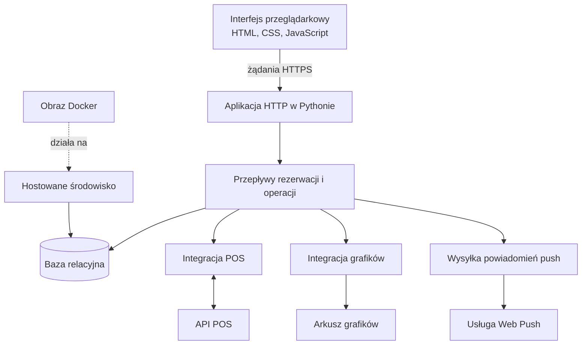
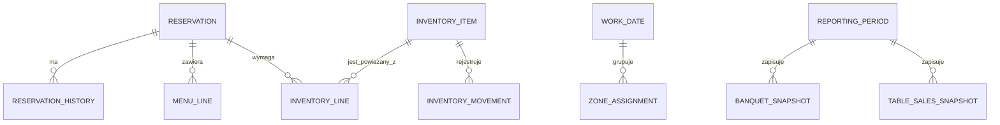

# Przegląd architektury

## Kształt systemu

Produkt jest niewielką aplikacją webową w Pythonie. Obsługuje przeglądarkowy interfejs mobilny i przepływy operacyjne. CSS jest budowany jako zasób przed wdrożeniem, a aplikację pakuje się do Dockera i uruchamia na hostowanej platformie.

## Trwałość danych i ich pochodzenie

- **Rekordy operacyjne:** rezerwacje, historia zmian, przypisania personelu, inwentura i powiązane zadania.
- **Zewnętrzne dane referencyjne:** wybrane dane menu i produktów POS, odświeżane i lokalnie odwzorowywane tam, gdzie są potrzebne.
- **Grafiki:** pobierane z arkusza i odświeżane w widokach aplikacji.
- **Migawki raportowe:** zapisane wartości używane w historycznych raportach, oddzielone od bieżącej edycji rezerwacji.
- **Lokalny rozwój:** SQLite upraszcza uruchomienie środowiska.
- **Wdrożenie hostowane:** PostgreSQL przechowuje dane relacyjne.

## Konceptualne relacje encji

Nazwy encji są uogólnione na potrzeby portfolio. Diagram nie jest eksportem produkcyjnego schematu.

## Zasady integracji

1. Wywołania dostawców zewnętrznych pozostają za modułami integracyjnymi.
2. Dane operacyjne należące do aplikacji są odróżnione od danych odczytywanych ze źródeł zewnętrznych.
3. Wartości raportowe są zapisywane w migawkach, gdy potrzebny jest stabilny widok historyczny.
4. Baza środowiska testowego jest odizolowana od produkcyjnej.
5. Zmiany schematu produkcyjnego wykonuje się jawnym poleceniem migracji, a nie podczas startu aplikacji.

## Dobór technologii

| Obszar | Technologia | Zastosowanie |
|---|---|---|
| Aplikacja | Python 3.12+ | Obsługa HTTP i przepływy operacyjne |
| Interfejs | HTML, CSS, JavaScript | Mobilny interfejs w przeglądarce |
| Budowanie CSS | Vite i PostCSS | Budowanie i minifikacja zasobów CSS |
| Lokalna baza | SQLite | Samodzielne środowisko deweloperskie i lokalna demonstracja |
| Baza hostowana | PostgreSQL | Relacyjna baza danych dla wdrożenia hostowanego |
| Wdrożenie | Docker i Fly.io | Powtarzalny obraz aplikacji i hostowane środowisko |
| Integracja POS | API Syrve | Przepływy rezerwacji, menu i raportowania |
| Źródło grafik | Google Sheets API | Odczyt grafików personelu |
| Powiadomienia | Web Push | Powiadomienia przeglądarkowe |
