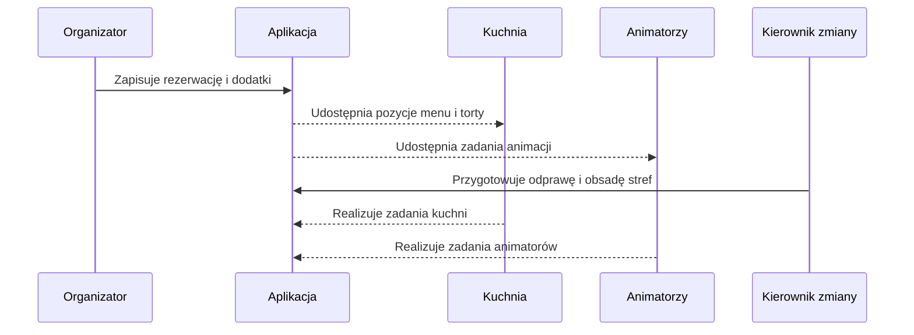

# Przepływ dnia pracy

KidsOffice wiąże pracę kilku działów wokół wspólnego planu dnia. Poniższy przykład pokazuje, jak jedna rezerwacja przechodzi przez system.

## Od rezerwacji do realizacji

1. **Organizator** tworzy bankiet lub rezerwację stolika. W bankiecie zapisuje między innymi termin, liczbę gości, lokalizację na planie sali i zamówione dodatki.
2. **Kuchnia** korzysta z pozycji menu, tortów, owoców i warsztatów przypisanych do rezerwacji. Każdy tort może mieć własne zdjęcie i godzinę wydania.
3. **Animatorzy** widzą zaplanowane animacje, warsztaty, piniaty i maskotki. W osobnym widoku przygotowują poranne lub wieczorne zadania sprzątania.
4. **Kierownik zmiany** przygotowuje odprawę i przypisuje kelnerów do stref sali. Przypisanie kelnera do strefy jest oddzielone od lokalizacji rezerwacji na planie.
5. **Recepcja i organizatorzy** korzystają z kart rezerwacji podczas obsługi dnia. Historia pozwala odtworzyć, która rola zapisała zmianę.

## Grafiki i obsada

Grafiki działów są pobierane z arkusza i wyświetlane w układzie tygodniowym lub miesięcznym. Odprawa korzysta z osobnych przypisań kelnerów do stref, a zadania animatorów łączą osoby z porannymi i wieczornymi falami sprzątania.

Rola personelu jest przypisana do urządzenia, natomiast widok działu określa aktualnie otwarty ekran. Dzięki temu użytkownik może przełączać się między dostępnymi ekranami bez zmiany roli urządzenia.

## Raportowanie

KidsOffice rozdziela sprzedaż powiązaną z bankietami od sprzedaży stolikowej z codziennej obsługi. Dane są zapisywane w migawkach miesięcznych, co pozwala zachować widok okresu niezależnie od późniejszych zmian w rezerwacjach.

Raporty wykorzystują dane zewnętrzne z Syrve. Jeśli dla okresu nie ma migawki sprzedaży stolikowej, system pokazuje brak danych zamiast sugerować, że sprzedaż wyniosła zero.
